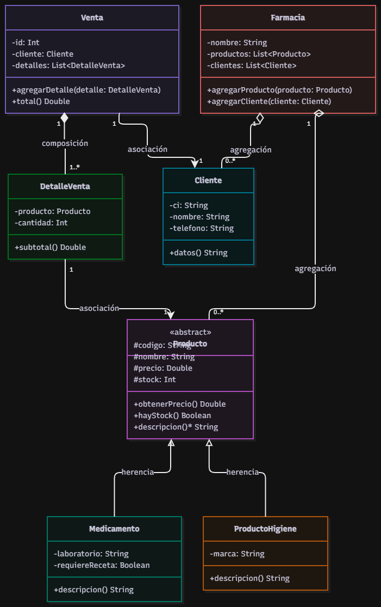
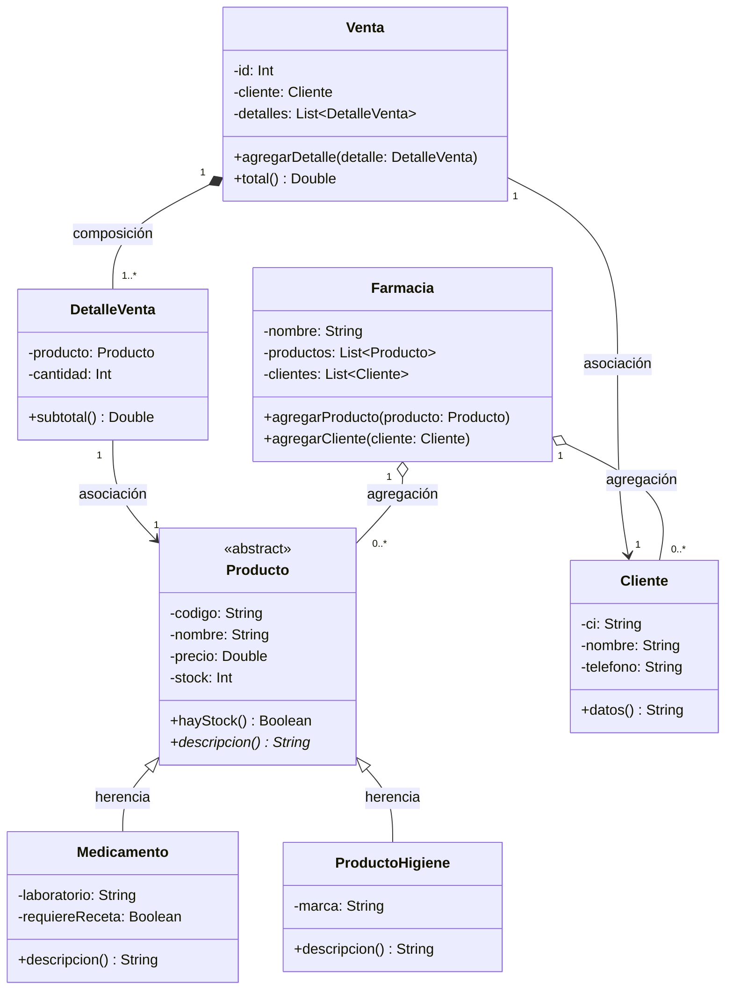

# Farmacia App – Primer Parcial Programación III

**Estudiante:** Kadir Felipe Miranda Laura
**Caso de estudio:** Farmacia

## Checkpoint 1 – Modelo de clases

### Descripción de las clases
| Clase | Responsabilidad |
|---|---|
| Producto (abstracta) | Datos comunes de todo producto: código, nombre, precio y stock. |
| Medicamento | Producto con laboratorio y si requiere receta. |
| ProductoHigiene | Producto de cuidado personal con marca. |
| Cliente | Persona que compra en la farmacia. |
| DetalleVenta | Un producto vendido con su cantidad y subtotal. |
| Venta | Compra de un cliente, formada por uno o más detalles. |
| Farmacia | Contiene la lista de productos y clientes. |

### Conceptos de POO aplicados
- **Herencia:** Medicamento y ProductoHigiene heredan de Producto.
- **Abstracción:** Producto es abstracta y obliga a implementar `descripcion()`.
- **Polimorfismo:** cada subclase implementa `descripcion()` a su manera.
- **Encapsulamiento:** atributos privados (`-`) con métodos públicos (`+`).